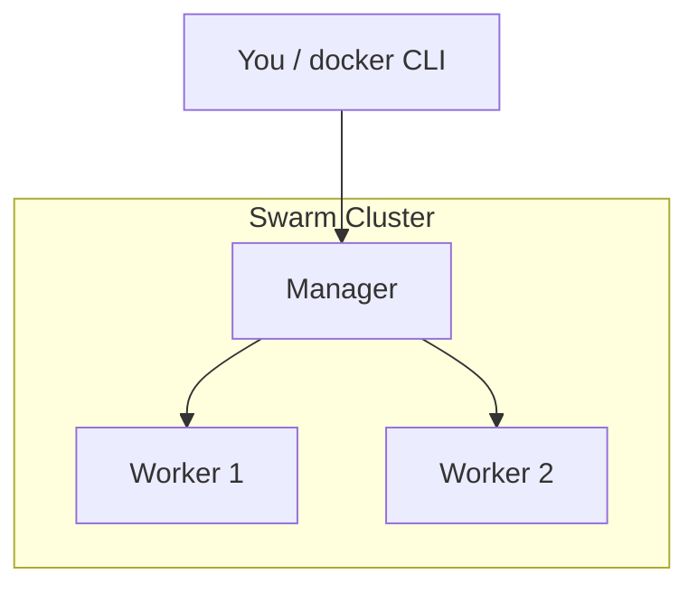
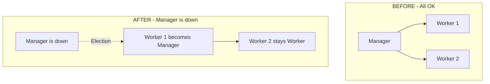
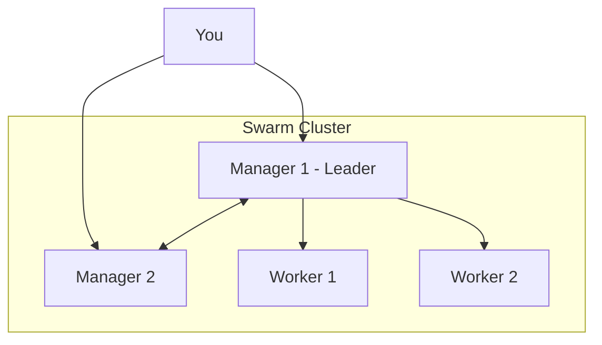
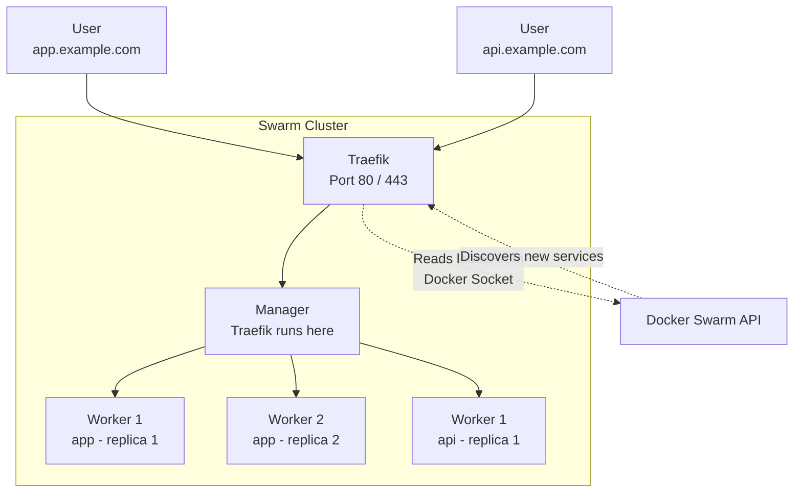

# Docker Swarm - Basics

## What is it?

Docker Swarm is Docker's mode for joining multiple machines and making them work as if they were **a single Docker**.

You tell it to run a container and Swarm decides on which machine it will run.

### Roles

*   **Manager:** The boss. Decides where containers will run and stores the cluster state.
*   **Worker / Node:** The worker. It only runs the containers that the Manager tells it to.

---

## 1. Basic Cluster: 1 Manager + 2 Workers



**How it works:**
1. You run `docker service create --replicas 4 nginx`
2. The Manager receives the request
3. It distributes the replicas among the Workers
4. If a Worker goes down, the Manager starts its containers on another Worker

---

## 2. If the Manager goes down



**How it works:**
1. Nodes keep talking to each other all the time
2. If the Manager disappears, the others notice
3. They run an election using the Raft algorithm
4. One of the nodes is promoted to Manager and takes control

> For this to work, the node must have been promoted with `docker node promote`.

---

## 3. Swarm with 2 Managers + 2 Workers



**How it works:**
1. The 2 Managers keep an identical copy of the state
2. One is the Leader, the other is the backup
3. If the Leader goes down, the other takes over

**WARNING: 2 Managers is bad!**

Swarm uses **quorum** to decide. It needs a majority.

*   With 1 Manager: needs 1. OK.
*   With 3 Managers: needs 2. If 1 goes down, 2 remain. OK.
*   With 2 Managers: needs 2. If 1 goes down, only 1 remains. **NO QUORUM, the cluster freezes!**

### Golden rule

**Always use an ODD number of Managers: 1, 3 or 5.**

| Managers | Quorum | How many can fail? |
| :--- | :--- | :--- |
| 1 | 1 | 0 |
| 3 | 2 | 1 |
| 5 | 3 | 2 |

---

## 4. Test Swarm

### Test file

Create a file named `docker-stack.yml` in the same folder:

```yaml
services:
  web:
    image: nginx:alpine
    deploy:
      replicas: 3
      restart_policy:
        condition: on-failure
    ports:
      - "8080:80"
    networks:
      - my-network
networks:
  my-network:
    driver: overlay
```

### Step by step

```bash
# 1. Start Swarm - your machine becomes Manager
docker swarm init

# 2. List the cluster nodes
docker node ls

# 3. Deploy the test stack
docker stack deploy -c docker-stack.yml test

# 4. List services
docker service ls

# 5. See where each replica went
docker service ps test_web
```

Open in your browser: `http://localhost:8080`

### Tests to try

```bash
# Scale from 3 to 5 replicas
docker service scale test_web=5

# Scale back to 2
docker service scale test_web=2

# List running containers
docker ps

# Kill a container by force and watch Swarm recreate it
docker rm -f <container-id>
docker service ps test_web
```

### Clean up everything at the end

```bash
docker stack rm test
docker swarm leave --force
```

---

## 5. Exposing Applications with Traefik in Docker Swarm

Without a reverse proxy, you would need to expose a port for every app on every node. With Traefik, you expose only ports 80 and 443 once, and Traefik routes by domain name.



**How it works:**
1. Traefik runs as a Swarm service, usually only on Manager nodes.
2. It listens on ports 80 and 443 for all traffic.
3. It watches the Docker Socket and auto-discovers new services.
4. Each app tells Traefik its domain using `labels` in the `docker-stack.yml`, no manual config.
5. When a request arrives for `app.example.com`, Traefik forwards it to one of the replicas of that app, even if the replica is on another Worker, using the Swarm overlay network.
6. If you scale the app or a replica dies, Traefik updates the routes automatically.

### Example: Traefik + App in the same `docker-stack.yml`

```yaml
services:
  traefik:
    image: traefik:v3.1
    command:
      - "--api.dashboard=true"
      - "--providers.docker=true"
      - "--providers.docker.swarmMode=true"
      - "--providers.docker.exposedbydefault=false"
      - "--entrypoints.web.address=:80"
      - "--entrypoints.websecure.address=:443"
    ports:
      - "80:80"
      - "443:443"
      - "8080:8080"
    volumes:
      - /var/run/docker.sock:/var/run/docker.sock:ro
    networks:
      - my-network
    deploy:
      placement:
        constraints:
          - node.role == manager
      replicas: 1

  web:
    image: nginx:alpine
    networks:
      - my-network
    deploy:
      replicas: 3
      labels:
        - "traefik.enable=true"
        - "traefik.http.routers.web.rule=Host(`app.localhost`)"
        - "traefik.http.routers.web.entrypoints=web"
        - "traefik.http.services.web.loadbalancer.server.port=80"

networks:
  my-network:
    driver: overlay
```

### How to test

```bash
# Deploy the stack
docker stack deploy -c docker-stack.yml test

# See if Traefik discovered the app
docker service logs test_traefik

# Test routing - Traefik routes by Host header
curl -H "Host: app.localhost" http://localhost:80

# Open the dashboard
# http://localhost:8080/dashboard/
```

### Golden rules for Traefik + Swarm

*   **Always** put Traefik and the apps on the **same overlay network**, otherwise Traefik cannot reach them.
*   Labels go inside `deploy:` -> `labels:`, NOT in the service root. In Swarm, only `deploy.labels` are read.
*   Use `node.role == manager` for Traefik, so it always has access to the Docker Socket.
*   Never expose your app ports with `ports:` when using Traefik. Only Traefik exposes 80 / 443.

---

## Useful commands

```bash
# Show token to join other nodes
docker swarm join-token manager
docker swarm join-token worker

# Join a node as worker
docker swarm join --token <token> <manager-ip>:2377

# Promote a worker to manager
docker node promote <node-name>

# Create a service with 3 replicas
docker service create --name web --replicas 3 nginx
```